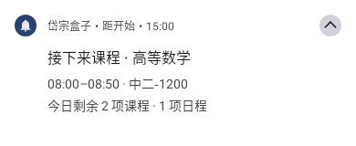
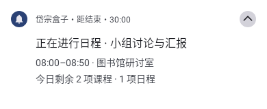

# 动态课程与日程通知

设置 → 通知与提醒 → 动态通知，默认关闭。开启后静默展示今天正在进行的一项安排；没有进行项时展示下一项。展开通知可看今日尚未结束的课程、日程数量，包含当前这一项。点按进入日程页。今天没有剩余安排时收起，次日重新计算。

数据来自当前账号、本学期的本地课表及自建日程，与日程页共用周次和冬夏作息；节假日不展示教务课程，自建课程、日程仍保留。缺少学期开始日期时不猜周次，先打开日程同步。不会为通知额外联网、查询考勤，也不展示未经核实的打卡状态。

倒计时使用系统通知的 chronometer，课前倒数到开始，进行中倒数到结束。使用系统通知模板，随系统深浅色、大字体和各厂商通知样式适配；不是厂商专有的超级岛/流体云。独立 LOW 渠道，不响铃、不振动、不计角标，锁屏内容默认私密。

## 后台切换与权限

- 开启时按需申请系统通知权限，拒绝时保持关闭。系统通知设置中可单独关闭「动态课程与日程」渠道。
- 「准时切换通知」可进入系统「闹钟和提醒」授权。允许后使用 `setExactAndAllowWhileIdle`；未允许时回退 `setAndAllowWhileIdle`，后台切换可能被系统推迟。应用回到前台会立即重算。
- 每次只排一个下一边界闹钟（任一安排开始、结束或校园时区午夜），没有常驻前台服务，也不按分钟启动 Worker。精确闹钟在深度休眠中仍受系统的频率限制。
- 通知设置超时，在下一边界先撤掉旧内容，后台延迟时可能短暂没有卡片，避免继续显示已过时的倒计时。强行停止应用会停止系统排程，需重新打开；撤回精确闹钟权限时 Android 会结束进程并清除精确闹钟，也需重新打开以恢复降级排程。
- 课表同步、日程增删改、助手写入日程、切换账号、退出、清缓存、回到前台、重启、换包和调整时间后重算。通知仅取持久化激活账号，读取期间切号则丢弃旧轮次。关闭功能会撤下通知并取消闹钟。

## 验证

`DynamicSchedulePlanTest` 覆盖时间边界、重叠、节假日、分钟级日程、冬夏作息、空课表、周次和校园时区。`DynamicScheduleNotificationTest` 用 Robolectric 验证系统倒计时、点击路由、静默与私密渠道、超时、单通知覆盖、取消及精确闹钟降级。

```powershell
./gradlew.bat :app:testDebugUnitTest :app:assembleDebug -PdebugSuffix --no-configuration-cache
```

真机验收可在今天添加一个几分钟后开始的自建日程，再开启动态通知；检查倒计时、开始/结束切换、点按进入日程、编辑/删除后刷新、关闭后的撤销及切号隔离。精确授权和未授权两种模式分别检查，未授权模式接受后台延迟。截图不包含真实个人课表。

系统模板离屏渲染示例（Android 15 / Robolectric，测试数据，非真机通知栏）：





系统约束见 Android 官方文档：[闹钟调度与精确权限](https://developer.android.com/develop/background-work/services/alarms)、[通知计时器](https://developer.android.com/reference/androidx/core/app/NotificationCompat.Builder#setChronometerCountDown(boolean))。

2026-11-03 在 adb 真机 2509FPN0BC（Android 17 / API 37）使用独立临时包与虚构数据验证：课程课前、日程进行态、回收后台进程后在开始边界重新拉起并切换到距结束、结束后自动收起、关闭后撤销。主 Activity 启动返回 `Status: ok`（WARM，347 ms）；未登录校园账号。测试后卸载临时包，保留原正式版和 debug 包。下图仅裁出目标通知卡片，未修改通知内容：


